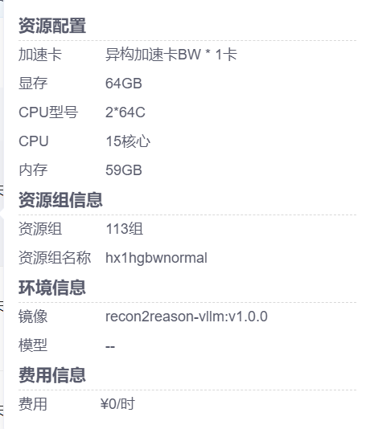

# Recon2Reason-Reasoning-4B · BW × vLLM 技术报告

## 1. 简介

- [SCNet模型来源](https://www.scnet.cn/ui/aihub/models/sugon_scnet/Recon2Reason-Reasoning-4B)
- [发布者模型说明](https://huggingface.co/BAAI/Recon2Reason-Reasoning-4B)
- [SCNet专用镜像](https://www.scnet.cn/ui/aihub/image/zack233/2116559999150473218)
- [光合代码仓库](https://developer.sourcefind.cn/codes/zhengke/gxgm-hks)，模型目录 `Recon2Reason-Reasoning-4B-vLLM/`

本项目在SCNet单张BW上完成原版BF16 Recon2Reason-Reasoning-4B的vLLM适配。模型采用Qwen3-VL架构，约4.44B参数，使用vLLM原生 `Qwen3VLForConditionalGeneration` 与镜像内HCU插件，提供文本、单图、多图、多轮及流式OpenAI接口。模型权重、结构、tokenizer及框架算子源码均未修改。SGLang版本保留在另一个目录，两框架结果分别记录。

| 验证项 | 本版实测 |
|---|---|
| 功能 | 专用镜像内两个独立服务进程各5/5 |
| 正式性能 | 官方六档×两次×两个独立服务进程，1216条矩阵请求全部完成，每条输出1024 token |
| 复现 | 模板表内9类指标共54个对照，最大偏差9.6517%，≤20% |
| 精度 | 赛事对本模型不要求精度；未将功能或随机压测当作精度成绩 |
| 镜像范围 | 专用镜像的新Notebook内完成完整功能与性能矩阵 |
| 官方验收 | 由主办方审核，本报告不声明已获官方验收 |

## 2. 验证环境

| 项目 | 实际配置 |
|---|---|
| 平台 | SCNet Notebook |
| 卡型、显存、并行 | BW×1，64GB，gfx936，80 CU；TP1；BF16 |
| Notebook分配 | CPU15核、内存59GB；CPU型号标签2×64C |
| 资源组 | 113组，hx1hgbwnormal |
| 区域与磁盘配额 | 已存资源配置页没有列出区域名称和磁盘配额，不根据资源组名称推断 |
| 共享存储 | `/root/private_data` 已挂载，代码和结果位于共享项目目录 |
| 镜像 | `appstore.scnet.cn:5000/aihub/dcu/zack233/recon2reason-vllm:v1.0.0`，版本 `v1.0.0` |
| Python / DTK / HIP | Python3.10.12；DTK26.04软件栈；Torch HIP6.3.26113 |
| 服务映射 | 本地127.0.0.1:30123，未使用外部服务映射 |

平台配置证据：



| 组件 | 实际版本 |
|---|---|
| torch | `2.11.0+dtk2604.2609201441.gf74cd7` |
| vllm | `0.25.1+das185.dtk2604.torch2110.2608171710.g7b108a` |
| vllm-hcu | `0.25.1+dtk2604.torch2110.2609272150.gee325d` |
| sglang | `0.5.18+dtk2604.torch2110.2609231937.gc3bbbd` |
| triton | `3.6.0+dtk2604.torch2110.2609231415.g8cce4a` |
| transformers | `5.12.1` |
| openai | `2.30.0` |
| Pillow | `11.3.0` |
| tokenizers | `0.22.2` |

完整运行环境记录为 `env.log`、`results/environment.json`。其中Python运行时看到的宿主CPU数不代表Notebook分配CPU核数，分配规格采用平台配置页数值。

## 3. 适配与配置

专用Dockerfile见 `Dockerfile.scnet`，基础镜像为 `image.ac.com:5000/dcu/zack233/base/sglang-jupyter:0.5.18`。镜像固化API依赖，保留Jupyter/SSH启动方式；运行通过 `PYTHONPATH=/opt/qwen3-asr-deps` 使用OpenAI2.30.0，未在新Notebook升级全局Torch、vLLM或Transformers。

正式配置为上下文32768、显存比例0.80、最大运行序列64、TP1、BF16、eager、多图上限2、数学库线程4。框架默认prefix cache与chunked prefill开启，配置原文见正式任务各进程 `server.log`。镜像内启动样例采用诊断默认值；正式测试使用本仓库脚本提供上述完整配置。权重存放在共享模型目录，不打入镜像或源码包。

模型运行文件校验记录保留于 `results/preflight.json`。本版不涉及量化，也没有需要重放的框架算子补丁。

## 4. 启动与复现

将仓库模型目录部署到 `/root/private_data/hks/models/Recon2Reason-Reasoning-4B-vLLM`，公共 `platform/scnet-notebook` 目录部署到 `/root/private_data/hks/platform/scnet-notebook`。专用镜像内也提供运行环境脚本。权重使用 `env.sh` 中社区默认路径，或通过 `MODEL_PATH` 指定完整模型目录。Notebook已是容器，直接执行：

```bash
cd /root/private_data/hks/models/Recon2Reason-Reasoning-4B-vLLM
bash run.sh              # 记录server.log并轮询health，准备好后返回
bash env_check.sh        # 记录env.log和environment.json
bash smoke.sh
bash stop.sh
bash bench.sh            # 从空闲30123端口启动完整矩阵及独立服务复跑
python verify.py         # CPU重算已有证据、正式矩阵及特殊token定位证据
```

服务提供 `/health`、`/v1/models`、`/v1/chat/completions`，模型名 `recon2reason-4b`。新任务使用独立时间戳目录，由 `results/formal-current.json` 指向；已有发布证据不覆盖。

发布启动入口另按启动→环境采集→5项Smoke→停止顺序实跑通过，日志为 `results/entrypoint-check.log`；不是只检查文件名。诊断脚本需要模型环境时可通过 `bash run-scnet.sh python scripts/<脚本>.py` 执行。

## 5. 功能测试

正式矩阵的两个独立服务进程各完成5/5项检查：文本算术返回5；单图左侧矩形返回red；双图按顺序返回red, blue；多轮继续询问右侧返回blue；单图SSE流式返回red并收到 `[DONE]`。合成图、完整请求和原始响应保留于 `results/smoke-20261031T163623Z` 与 `results/smoke-20261031T175818Z`。

另保留原镜像与专用镜像的小负载功能/性能诊断。上述合成输入用于验证API链路和简单语义，不代表空间推理精度测试。

## 6. 精度测评

依据赛事说明，Recon2Reason-Reasoning-4B属于不要求精度测试的模型，来源记录为 `sources/competition-policy-20261028.json`。本vLLM版本未测OCRBench、MMMU或动作一致率，没有引用SGLang版成绩作为本版成绩，也没有将随机token性能输出当作精度结果。

## 7. 首次性能

按官方模板执行4K/16K文本长度参数×固定输出1K×并发1/8/64，N=max(8,2C)。每档连续两次，第一次预热，第二次计入；重新启动独立服务完整复跑一次。单进程608条、两进程1216条矩阵请求，另有客户端内置warmup和功能请求，不混入该计数。两个进程均位于专用镜像创建的新Notebook，实际任务日期为北京时间2026-11-01。

客户端为镜像内SGLang压测工具，后端 `vllm-chat`，每请求1张1080p随机JPEG，seed1；温度0、ignore_eos固定工作量、流式usage返回实际token计数。图像处理和chat template增加实际输入长度，表中4096/16384是文本长度参数。默认缓存状态保留，每档第二次不代表冷前缀性能。

第一进程的第二次结果如下，时间单位均为毫秒（duration为秒）：

| random_input_len | random_output_len | max_concurrency | completed | duration | request_throughput | output_throughput | total_throughput | mean_ttft_ms | p99_ttft_ms | mean_tpot_ms | p99_tpot_ms | mean_e2e_latency_ms |
|---|---|---|---|---|---|---|---|---|---|---|---|---|
| 4096 | 1024 | 1 | 8 | 387.5294 | 0.0206 | 21.1390 | 111.4832 | 187.8506 | 201.3708 | 47.1675 | 48.3137 | 48440.2294 |
| 4096 | 1024 | 8 | 16 | 100.1479 | 0.1598 | 163.5980 | 862.5240 | 404.0010 | 479.6416 | 48.5086 | 48.5821 | 50028.2987 |
| 4096 | 1024 | 64 | 128 | 234.1158 | 0.5467 | 559.8598 | 2947.1829 | 10737.9139 | 31476.6352 | 82.1714 | 121.9079 | 94799.2748 |
| 16384 | 1024 | 1 | 8 | 390.9950 | 0.0205 | 20.9517 | 375.3296 | 271.9111 | 289.6326 | 47.5089 | 47.8602 | 48873.4819 |
| 16384 | 1024 | 8 | 16 | 102.9661 | 0.1554 | 159.1203 | 2848.4701 | 1000.3124 | 1198.2243 | 49.2243 | 49.6386 | 51356.7614 |
| 16384 | 1024 | 64 | 128 | 759.5205 | 0.1685 | 172.5720 | 3088.5632 | 214076.4950 | 317549.1978 | 92.8312 | 268.9488 | 309042.8235 |


原始文件为 `bench/round1.jsonl`、`bench/round2.jsonl`，第二进程为 `bench/reproduce/`；这些是 `results/formal-20261031T163337Z` 下对应原始JSONL的同字节副本。完整服务/客户端/检查日志位于该任务目录，原始文件未删减。该组结果作为本模型×BW×vLLM×BF16的首版性能基准，不与SGLang或小负载诊断计算优化收益。

### 随机压测的特殊token输出

16K/64并发的固定请求索引71和98，每次均生成1024个特殊token `<|feat_pad|>`（ID151673）。四次重复共8条都计入请求数和吞吐分母。默认解码隐藏特殊token，因此这些记录的可见文本为空，原始客户端将TTFT记0、ITL列表为空；**0表示没有可见文本到达，不能解释为真实首token耗时为0**。该档的TTFT/TPOT统计保留客户端原值，受此显示定义限制，不用于自然交互延迟解释。

独立重建相同seed输入后，显示/隐藏特殊token两侧实际1024个token IDs完全相同。发布者Transformers5.12.1/SDPA、同BF16权重路径另测两个输入，各生成64个相同特殊token，与vLLM前64个ID一致。未改变正式压测的输入、采样或输出文件。具体请求定位、后端完整响应和发布者参考见 `results/empty-output-diagnosis/README.md`。CPU核验只认可这两个有实际证据的特殊输出，其他空输出仍拒绝；没有删除样本或伪造非空回答。

## 8. 复现与限制

比较两个独立进程各档的第二次结果：

| 文本长度参数 | 并发 | 首次输出token/s | 复跑输出token/s | 该档模板9类指标最大偏差 |
|---:|---:|---:|---:|---:|
| 4096 | 1 | 21.1390 | 21.1160 | 9.6517% |
| 4096 | 8 | 163.5980 | 162.0838 | 7.7661% |
| 4096 | 64 | 559.8598 | 557.6331 | 0.4488% |
| 16384 | 1 | 20.9517 | 20.9111 | 4.6277% |
| 16384 | 8 | 159.1203 | 159.1872 | 2.8889% |
| 16384 | 64 | 172.5720 | 172.8160 | 0.2630% |

模板表的duration、请求/输出/总token吞吐、mean/p99 TTFT、mean/p99 TPOT、mean E2E共54个比较值，最大偏差 **9.6517%**（4K、并发1的p99 TTFT），均≤20%。吞吐、mean TTFT、mean TPOT、mean E2E四类指标的最大值为7.7661%；不能将该值写成包含p99的全表最大值。两个进程均成功完成正式矩阵和5项功能检查；本版复现范围明确为新镜像Notebook中的两个独立服务进程。

16K/64并发的平均E2E约309秒，不外推为交互延迟。上述8条特殊token输出及其可见内容计时限制原样保留。原有小负载诊断采用不同配置和输出长度，仅作为历史诊断，不能替代正式矩阵。本版没有同负载优化前后对照，不声明10%优化提升。

`python verify.py` 执行完整已有证据检查；`--diagnostic-only`仅检查早期小负载。`scripts/test_formal_verifier.py` 的正例及修改后端token、修改发布者参考两项反例均通过。实际赛事验收由主办方审核。
